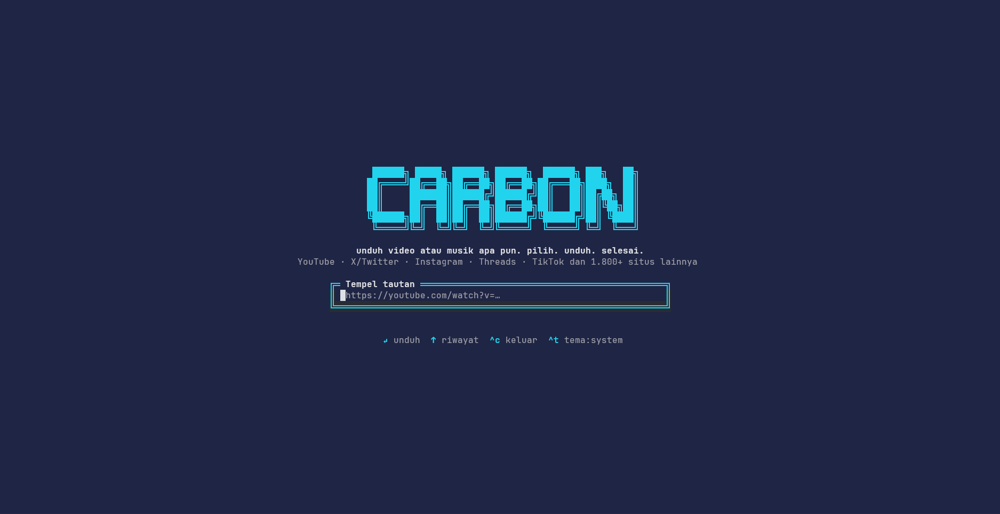
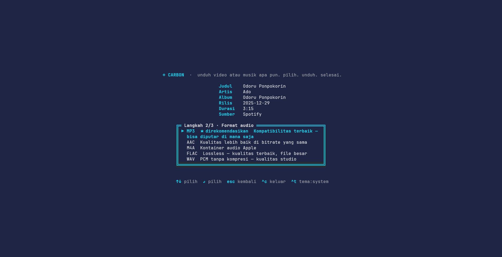

<div align="center">

<pre>
 ██████╗ █████╗ ██████╗ ██████╗  ██████╗ ███╗   ██╗
██╔════╝██╔══██╗██╔══██╗██╔══██╗██╔═══██╗████╗  ██║
██║     ███████║██████╔╝██████╔╝██║   ██║██╔██╗ ██║
██║     ██╔══██║██╔══██╗██╔══██╗██║   ██║██║╚██╗██║
╚██████╗██║  ██║██║  ██║██████╔╝╚██████╔╝██║ ╚████║
 ╚═════╝╚═╝  ╚═╝╚═╝  ╚═╝╚═╝      ╚═════╝ ╚═╝  ╚═══╝
</pre>

**grab any video or music. pick. download. done.**

YouTube · X/Twitter · Instagram · Threads · TikTok and 1,800+ other sites

[](https://github.com/AlFarrizi-Studio/Carbon-DL/releases)
[](https://nodejs.org)
[](LICENSE)
[](https://github.com/AlFarrizi-Studio/Carbon-DL/releases)

</div>

---

**Carbon** is a terminal-based video & audio downloader with a beautiful interactive UI. Paste any link from YouTube, TikTok, Instagram, X, SoundCloud, or 1800+ other sites, and Carbon walks you through picking exactly what you want — format, resolution, FPS, bitrate.

## ✨ Features

- 🎬 **Video downloads** — MP4, MKV, WEBM, MOV, AVI
- 🎵 **Audio / music downloads** — MP3, AAC, M4A, FLAC, WAV
- 🎚️ **Audio bitrate picker** — 8 kbps up to 512 kbps (FLAC/WAV are lossless)
- 🖥️ **Resolution picker** — from 360p up to 4K
- 🎞️ **FPS picker** — source FPS, 24, 30, or 60
- 🖼️ **Cover art** — shows the video/music thumbnail in the wizard using native terminal graphics (Kitty, iTerm2, Sixel) with a half-block fallback
- 🎨 **Themes** — `system`, `dark`, or `light` (press `^t` to cycle live)
- 🌐 **1800+ sites** — powered by yt-dlp
- 🌍 **180+ languages** — auto-detects your system language, or pick any from the in-app picker
- 🔔 **Update notifications** — in-app badge when a new GitHub release is available
- 🔊 **Sound notifications** — a short chime on success, on a new release, and on errors
- ⚙️ **Settings panel** — `^s` opens sound, volume, theme, language and history
- 📋 **History** — recall recent links with ↑/↓
- 📱 **Android / Termux** — runs on your phone, saves straight to the device's Download folder
- ⚡ **Zero setup** — auto-downloads yt-dlp on first run, bundles ffmpeg fallback

<div align="center">

| Input screen | Download wizard |
|:---:|:---:|
|  |  |

</div>

## 🚀 Install

Pick your platform and run the one-liner. Then just run `carbon-dl`.

**Windows (PowerShell):**

```powershell
irm https://raw.githubusercontent.com/AlFarrizi-Studio/Carbon-DL/main/install.ps1 | iex
```

**Linux:**

```bash
curl -fsSL https://raw.githubusercontent.com/AlFarrizi-Studio/Carbon-DL/main/install.sh -o install.sh && bash install.sh
```

**macOS (Homebrew):**

```bash
brew tap AlFarrizi-Studio/Carbon-DL https://github.com/AlFarrizi-Studio/Carbon-DL
brew install AlFarrizi-Studio/Carbon-DL/carbon-dl
```

**Android (Termux):**

```bash
pkg install nodejs
curl -fsSL https://raw.githubusercontent.com/AlFarrizi-Studio/Carbon-DL/main/install.sh -o install.sh && bash install.sh
```

The installer detects Termux automatically and sets up `ffmpeg` and `yt-dlp` through
Termux's package manager (`pkg` / `pip`) instead of the desktop binaries, which
cannot run on Android.

Then run it:

```bash
carbon-dl
```

> **Node.js 18+** is required — if it's not installed, the installers download and set it up automatically. No npm needed!

### 📱 Android / Termux notes

Termux runs a real Linux userland, but it links against **Bionic** instead of glibc — so the
official `yt-dlp` and `ffmpeg` release binaries cannot run there. Carbon handles this by:

- **Node.js** → installed from Termux (`pkg install nodejs`) instead of the glibc tarball.
- **yt-dlp** → installed as a Python package (`pip install -U "yt-dlp[default]"`). Carbon also
  generates a `~/.carbon/bin/yt-dlp` shim that forwards to `python -m yt_dlp`, so everything
  keeps working even when the console script isn't on `$PATH`.
- **ffmpeg** → installed from Termux (`pkg install ffmpeg`). Without it, video+audio streams
  can't be merged and audio can't be converted.
- **Downloads** → saved to the phone's shared `Download` folder (`/storage/emulated/0/Download`)
  so they show up in the Gallery and Files apps. Run this once to enable it:

  ```bash
  termux-setup-storage
  ```

  Without it, files land in Termux's private folder instead. You can also point Carbon
  anywhere with `CARBON_OUT_DIR=/sdcard/Movies carbon-dl`.

If you installed Carbon manually (not via the script), make sure the tools are present:

```bash
pkg install ffmpeg python python-pip
pip install -U "yt-dlp[default]"
```

## 📖 Usage

```bash
carbon-dl                          # interactive — paste a link
carbon-dl https://youtu.be/xyz     # start with a link
carbon-dl --theme dark             # force dark theme
carbon-dl --no-sound               # mute notification sounds
carbon-dl --test-sound             # play the notification clips and exit
carbon-dl update                   # update to the latest version
carbon-dl update --force           # re-download even if already latest
carbon-dl uninstall                # remove Carbon completely
carbon-dl --help                   # show help
carbon-dl --version                # show version
```

## 🔊 Notification sounds

Carbon plays a short sound on three events:

| Sound | When |
|-------|------|
| `sound/1.mp3` | a download finished successfully |
| `sound/2.mp3` | a newer Carbon release is available |
| `sound/3.mp3` | something went wrong |

The clips are installed to `~/.carbon/sounds/` and played with whatever player
your system has — `afplay` (macOS), `paplay` / `mpv` / `ffplay` / `mpg123` /
`cvlc` (Linux), `termux-media-player` (Android), or the built-in Windows media
player (Windows). If none is available, Carbon simply stays silent.

Turn them off with `carbon-dl --no-sound` or `CARBON_SOUND=0`. Point Carbon at
a different folder of clips with `CARBON_SOUND_DIR=/path/to/sounds`.

The volume is adjustable in the settings panel (`^s`) and applies to every
player — `afplay -v`, `mpv --volume`, `ffplay -volume`, `paplay --volume`,
`cvlc --gain`, and the Windows media player.

Test the clips at any time — plays success → update → error in sequence:

```bash
carbon-dl --test-sound
```

### The wizard

1. **Paste a link** — Carbon detects the platform and fetches media info
2. **Step 1** — choose **Video** or **Audio/Music**
3. **Step 2** — choose your **format** (MP4/MKV/WEBM/MOV/AVI or MP3/AAC/M4A/FLAC/WAV)
4. **Step 3** — choose **resolution** + **FPS** (video) or **bitrate** (audio)
5. Watch the progress bar — file lands in `~/Downloads`

### 📺 Forcing a resolution & frame rate

The resolution and frame-rate lists are built from what the source **actually
offers**, so a 4K video shows 4K (and 8K when the source has it) instead of a
generic list:

```
▶ Best available   Highest quality source offers
  4320p (8K) ★
  2160p (4K) ★
  1440p (2K) ★
  1080p (Full HD) ★
  720p (HD) ★
  480p ★
  360p ★
```

- **★** — the source has that exact height. Picking it makes Carbon request
  *exactly* that height (`[height=2160]`), so a 4K source can never quietly
  land on 1080p.
- **dimmed** — the source cannot reach that height at all.
- **no star** — the closest available height will be used.

The same works for frame rate — picking `60 FPS` on a source that has it forces
`[fps=60]` instead of "60 or lower". The frame-rate list is relative to the
resolution you picked: YouTube often has 1080p only at 60 fps while 480p exists
at 30 fps, so Carbon shows what is actually reachable at that height.

Picking a lower resolution on a 4K source still works — you just get the
closest match instead of an exact one.

> Re-downloading the same video at a different quality **overwrites** the old
> file (Carbon passes `--force-overwrites`). Without that, yt-dlp sees the file
> already on disk and skips the download, leaving you with the previous quality.

> yt-dlp's `=` operator is a strict float comparison, so `[fps=60]` would not
> match a stream reporting 59.94 fps. Carbon forces frame rates with a narrow
> ±0.5 window instead, which still excludes the neighbouring rates.

Carbon also shows **what you actually got** once the download finishes:

```
✓ grabbed!  saved to:
/home/you/Downloads/Big Buck Bunny.mp4
2160p · 60fps · 3840px
```

If the requested quality is not offered by the default player client, Carbon
automatically retries with your browser cookies and other player clients —
YouTube only exposes 4K/8K to Premium or otherwise authenticated sessions.

### Keyboard shortcuts

| Key | Action |
|-----|--------|
| `↵` | submit / select |
| `↑↓` | navigate choices / history |
| `←→` | change the selected setting |
| `esc` | go back / cancel |
| `^t` | cycle theme (system → dark → light) |
| `^l` | open language picker (180+ languages, searchable) |
| `^s` | open settings (sound, volume, theme, language, history) |
| `^c` | quit |

## ⚙️ Settings

Press `^s` inside the app to open the settings panel:

```
╔═ Settings ═════════════════════════════════════════╗
║ ▶ Theme                                      theme ║
║   Notification sound                          ✓ on ║
║   Volume                                       80% ║
║   Language                        Bahasa Indonesia ║
║   Clear history                                  ↵ ║
║                                                    ║
║ ↑↓ select · ←→ change · ↵ change · esc close       ║
╚════════════════════════════════════════════════════╝
```

- `↑↓` picks a row, `←→` (or `↵`) changes its value
- Changing the **volume** plays a preview so you hear the new level
- Everything is saved to `~/.config/carbon/settings.json` and restored on the
  next launch
- `^t` still cycles the theme quickly, and it updates the saved preference too

## 🎨 Themes

```bash
carbon-dl --theme system   # follow terminal colors (default)
carbon-dl --theme dark     # dark-optimized palette
carbon-dl --theme light    # light-optimized palette
```

Press `^t` inside the app to cycle themes live.

## 🌍 Languages

**180+ languages** — Carbon auto-detects your system language. You can override it at any time without restarting:

- **In-app:** press `^l` to open the searchable language picker — works from every phase (input, wizard, downloading, done, error). The list is sorted by native name, and typing filters it instantly. Pick any of 180+ supported languages and the UI re-renders immediately.
- **CLI / env var:** set `CARBON_LANG` before launch to force a language for the whole session.

```bash
CARBON_LANG=id carbon-dl    # force Indonesian
CARBON_LANG=ja carbon-dl    # force Japanese
CARBON_LANG=jv carbon-dl    # force Javanese
```

### What's covered

| Family | Examples |
|--------|----------|
| Major world languages | English, Indonesian, Spanish, French, German, Portuguese, Italian, Russian, Japanese, Korean, Chinese (Simplified & Traditional), Arabic, Hindi, Turkish, Vietnamese, Thai, Malay, Dutch, Polish, Ukrainian, Swedish, Danish, Finnish, Czech, Greek, Hebrew, Persian, Urdu, Bengali, Tamil, Telugu, Kannada, Malayalam, Marathi, Gujarati, Punjabi, Odia, Assamese, Nepali, Sinhala, Khmer, Lao, Burmese, Tibetan, Dzongkha, Uyghur, Kazakh, Mongolian, Pashto, Kurdish |
| Celtic & regional Romance | Irish, Scottish Gaelic, Welsh, Breton, Occitan, Asturian, Aragonese, Corsican, Sardinian, Neapolitan, Venetian, Lombard, Piedmontese, Romansh, Friulian |
| Germanic & Nordic regional | Low German, Alemannic, Limburgish, Faroese, Greenlandic, Northern & Southern Sami, Yiddish |
| Slavic & Turkic regional | Belarusian, Russian, Ukrainian, Bulgarian, Serbian, Croatian, Bosnian, Macedonian, Czech, Slovak, Polish, Slovenian, Tatar, Bashkir, Chuvash, Udmurt, Yakut, Chechen, Ossetian, Avar |
| South & Southeast Asia | Sindhi, Dogri, Konkani, Manipuri, Kashmiri, Bhojpuri, Goan Konkani, Burmese, Shan, Zhuang, Hmong, Tibetan, Thai, Lao, Khmer, Vietnamese, Malay, Tagalog, Cebuano, Ilocano, Waray, Hiligaynon, Kapampangan, Bikol, Tausug |
| Indonesian & Malay world | Indonesian, Malay, Javanese, Sundanese, Balinese, Madurese, Sasak, Buginese, Acehnese, Minangkabau, Minahasa, Batak |
| Africa | Swahili, Amharic, Tigrinya, Oromo, Somali, Hausa, Yoruba, Igbo, Twi/Akan, Ewe, Fula, Wolof, Zulu, Xhosa, Ndebele, Tsonga, Venda, Swati, Sesotho, Setswana, Shona, Chichewa, Kinyarwanda, Lingala, Luganda, Malagasy |
| Americas & Pacific | Guaraní, Quechua, Aymara, Nahuatl, Chamorro, Hawaiian, Māori, Samoan, Tongan, Fijian, Tuvaluan, Palauan, Niuean, Tok Pisin, Bislama, Papiamento |

Every language translates the core interface (steps, buttons, labels, statuses, progress). Anything not covered falls back to English, so the UI is never broken.

## 🔔 Updates

When a newer release is published on GitHub, Carbon shows a badge in the top-right corner:

```
↑ Update Carbon available: vX.Y.Z
```

To update, run:

```bash
carbon-dl update
```

This checks GitHub for the latest release and replaces the installed `cli.js` automatically — works on Windows, Linux, macOS, and Android (Termux). Use `--force` to re-download even when already on the latest version (useful for repairing a corrupted install).

Alternatively, re-run the install command for your platform above — it always fetches the latest release.

## 🗂️ Where files go

Downloads are saved to your `~/Downloads` folder.

On **Android (Termux)** they go to the phone's shared `Download` folder
(`/storage/emulated/0/Download`) so they appear in the Gallery and Files apps —
run `termux-setup-storage` once to enable it. Set `CARBON_OUT_DIR` to override
the location on any platform:

```bash
CARBON_OUT_DIR=/sdcard/Movies carbon-dl
```

## 🧰 How it works

- [yt-dlp](https://github.com/yt-dlp/yt-dlp) does the heavy lifting (extraction + download). Carbon auto-downloads the binary on first run if it's not on your PATH. On Android it uses the Termux/pip build instead, because the release binaries need glibc.
- [ffmpeg](https://ffmpeg.org) merges video+audio streams and converts formats. Carbon uses your system ffmpeg, or auto-downloads a static build on first run if none is found (on Android it installs Termux's `ffmpeg` package).
- Notification clips live in `sound/` and are installed to `~/.carbon/sounds/` by the installers.
- UI is built with [Ink](https://github.com/vadimdemedes/ink) (React for CLIs).
- Cover art is rendered via the best available terminal graphics protocol — Kitty (placeholders), iTerm2 (inline images), or Sixel (CPR-anchored) — with a universal half-block (▀) fallback. Image decoding uses [sharp](https://github.com/lovell/sharp) when available, falling back to [jimp](https://github.com/jimp-dev/jimp) (pure JS, bundled) so thumbnails always work even in the single-file installed build.

## 🛠️ Development

```bash
git clone https://github.com/AlFarrizi-Studio/Carbon-DL.git
cd Carbon-DL
npm install
npm run build
npm link          # makes `carbon-dl` available globally
```

| Script | Description |
|--------|-------------|
| `npm run build` | Build with tsup |
| `npm run dev` | Watch mode |
| `npm run typecheck` | TypeScript check |
| `npm start` | Run built CLI |

## 📄 License

[Apache-2.0](LICENSE)
